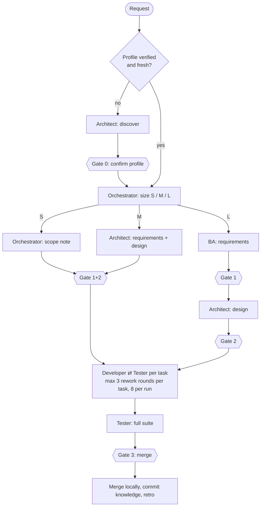
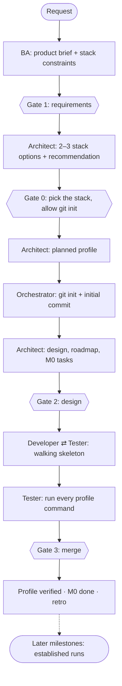

# dev-team-agents

A multi-agent software team for [Claude Code](https://claude.com/claude-code). It turns a rough request into a tested change, ready to merge. You approve the decisions that matter, and the agents do the rest.

You give the team a rough request such as "add authentication" or "build a booking app for a small clinic". A Business Analyst, an Architect, a Developer and a Tester, coordinated by an Orchestrator, analyze it, design a solution, implement it and test it. The team stops for your approval at a few defined **gates** and settles everything else among the agents. Nothing is merged without your approval, and nothing is ever pushed.

## Why

Give a single coding agent "add authentication", and it decides the scope, the design and sometimes the stack on its own. It then tests its own work, and spends whatever that takes. dev-team-agents changes three things:

- **Clear roles.** Each role has one job and only the permissions that job needs. The agent that writes the code is not the one that verifies it.
- **You decide at gates.** You approve the requirements, the design, the stack and the merge. Agents bring you only the questions they cannot settle themselves.
- **Bounded runs.** Token budgets and rework caps limit every run. Each run leaves a record in plain Markdown that you can read, edit and commit.

It is meant for developers who already use Claude Code and want more structure and control over larger changes, in a new project or an existing codebase, on any language or stack.

## Modes

The team works in two modes:

| Mode | Starting point | How the stack is set |
|---|---|---|
| **Greenfield** | An empty directory, or one with only a README, LICENSE or notes | The team **proposes** 2–3 stacks and you pick one |
| **Brownfield** | An existing codebase | The team **discovers** the stack, commands and conventions, and you confirm them |

Both modes produce the same file, `.team/project-profile.md`. After the first run the project is **established**, and every later request follows the same path whatever the project's origin.

> **Status: v0.1.0.** Validated end to end in headless (`claude -p`) runs on macOS: a Node/Express project, a Python/Flask project and a greenfield Python API. The results are in [docs/e2e-dry-run-notes.md](docs/e2e-dry-run-notes.md). Interactive sessions have not been validated yet (see [Known limitations](#known-limitations)).

## Contents

- [How it works](#how-it-works)
- [Principles](#principles)
- [Requirements](#requirements)
- [Install](#install)
- [Quick start: greenfield](#quick-start-greenfield)
- [Quick start: brownfield](#quick-start-brownfield)
- [Running headless](#running-headless)
- [Flows, sizes and gates](#flows-sizes-and-gates)
- [What the team writes into your project](#what-the-team-writes-into-your-project)
- [Learning](#learning)
- [Cost and budgets](#cost-and-budgets)
- [Safety](#safety)
- [Configuration](#configuration)
- [Resume, abort and rework](#resume-abort-and-rework)
- [Known limitations](#known-limitations)
- [Troubleshooting](#troubleshooting)
- [Update and uninstall](#update-and-uninstall)
- [Repository layout](#repository-layout)
- [Contributing](#contributing)

## How it works

```
You ──► Orchestrator (main session: claude --agent orchestrator)
           │  detects the mode, sizes the request, keeps the run state, asks you at gates
           ├─► architect · discover     → project-profile.md        (brownfield, first run)
           ├─► ba                       → requirements.md
           ├─► architect · propose      → stack-decision.md         (greenfield)
           ├─► architect · design       → design.md, tasks.md, roadmap.md
           ├─► developer                → code + commits, in an isolated git worktree
           └─► tester                   → test-report.md, test files
```

| Role | Model | Writes | Never |
|---|---|---|---|
| **Orchestrator** | Sonnet | `.team/` run state, learnings; merges after your approval | Writes code, pushes, merges without approval |
| **BA** | Sonnet | `requirements.md` | Touches source code |
| **Architect** | Opus (Haiku for discovery) | profile, stack decision, design, tasks, roadmap | Touches source code |
| **Developer** | Sonnet | Code and commits in its own git worktree | Pushes, merges, works in your main checkout |
| **Tester** | Sonnet (Haiku for the full pass) | `test-report.md`, test files | Edits production code (a defect becomes a finding) |

The agents talk through files in `<project>/.team/`, not through conversation. Every agent ends with one status line: `DONE`, `NEEDS_HUMAN`, `BLOCKED` or `NEEDS_REWORK`. The Orchestrator routes on it. When the Tester finds defects, the Orchestrator sends them back to the same Developer, at most 3 rounds per task and 8 per run, and then asks you.

## Principles

These principles shape every agent prompt, hook and script in this repo.

| Principle | How the team applies it |
|---|---|
| **Human in the loop at decision points** | Four gates (stack, requirements, design, merge). Agents raise anything only you can decide as `NEEDS_HUMAN`. The team never merges without your approval and never pushes. |
| **Separation of duties** | The Developer writes code but cannot merge. The Tester verifies but cannot edit production code: a defect becomes a finding. The BA and Architect never touch source code. |
| **Least privilege, enforced** | Per-role hooks limit each agent's file writes and shell commands. The rules do not rely on prompts alone. |
| **Bounded autonomy** | Soft and hard token budgets, rework caps, `maxTurns` per agent. A run is never upsized without your approval. |
| **Grounded, not guessed** | Agents use only build and test commands recorded in the project profile, and those commands are proven by running them. Stack versions are checked against official sources, not recalled from model memory. |
| **Context isolation, explicit hand-offs** | Each agent runs in its own context. Hand-offs go through files on disk, and agents reply with short summaries. This keeps contexts small and lets an interrupted run resume. |
| **Deterministic where possible** | Mode detection, fingerprints, token counting, budgets and rework caps are done by scripts, not by the model. |
| **Transparent, reviewable learning** | Lessons are plain Markdown files that you can read, edit and commit. Nothing becomes a cross-project rule without your approval. |
| **Right-sized effort** | Small requests skip steps. The strongest model is used only for design and stack decisions, where mistakes cost the most. |

The reasoning and the rejected alternatives for each choice are in [docs/design-decisions.md](docs/design-decisions.md).

## Requirements

- **Claude Code 2.1.295 or later.** The guard hooks use `onFailure: block`.
- The Claude Code config dir must be `~/.claude`. A custom `CLAUDE_CONFIG_DIR` is not supported, and the installer warns about it.
- `git`, and `jq` or `python3` (the hooks parse JSON). `install.sh --with-settings` needs `jq`.
- macOS or another Unix-like system with bash 3.2 or later. Only macOS has been tested.
- Access to the Opus, Sonnet and Haiku models on your Claude account.

## Install

```sh
git clone https://github.com/hcoz/dev-team-agents.git
cd dev-team-agents
scripts/install.sh --with-settings
```

This installs everything at user level, so the team is available in every project:

| From this repo | To |
|---|---|
| `agents/*.md` | `~/.claude/agents/` |
| `skills/<name>/` | `~/.claude/skills/<name>` |
| `templates/`, `playbooks/`, `hooks/` | `~/.claude/dev-team/` |

- **Symlinks by default**, so a `git pull` in this repo updates the installed team at once. Use `--copy` to copy instead. A failed symlink falls back to a copy.
- **`--with-settings`** merges [settings/settings.snippet.json](settings/settings.snippet.json) into `~/.claude/settings.json`. It adds the default token budgets, allow rules for the team's two helper scripts, and the install's directories as `additionalDirectories`, plus this repo's real path in symlink mode. Existing values are kept, and `settings.json` is backed up first. **Use it** unless you add the same entries yourself: the subagents run in the background and cannot ask for permission, so without these entries they cannot read the templates and playbooks.
- **Safe to re-run.** Anything at a target path that is not part of this install is moved to `~/.claude/dev-team-backups/<timestamp>/` first, and `uninstall.sh` restores it.
- **`--dry-run`** prints what would change and changes nothing.

Check the install:

```sh
ls -l ~/.claude/agents/orchestrator.md ~/.claude/dev-team/
```

In a Claude Code session, `/agents` should list `orchestrator`, `ba`, `architect`, `developer` and `tester`.

## Quick start: greenfield

```sh
mkdir clinic-booking && cd clinic-booking
claude --agent orchestrator
```

Then type your request, e.g. *"Build a booking app for a small clinic: patients book, staff confirm."* What happens:

1. **Mode:** the Orchestrator sees an empty directory and picks greenfield. A greenfield first run is always size **L**.
2. **BA** writes a product brief: users, scope, MVP, acceptance criteria and your stack constraints (languages you know, hosting, budget, must-use or must-avoid technologies). Missing answers come to you as questions.
3. **Gate 1 — Requirements.** You approve, change or abort.
4. **Architect** proposes 2–3 stacks with trade-offs and one recommendation, with versions checked against official sources.
5. **Gate 0 — Stack.** You pick a stack or change parts of it, and agree to `git init` with an initial commit if the directory is not a repo yet.
6. **Architect** writes the design, a milestone **roadmap** and the tasks for **M0**, a *walking skeleton*: project scaffold, tooling, CI and one thin end-to-end slice.
7. **Gate 2 — Design.**
8. **Developer ⇄ Tester** for each task. The Tester then runs every command in the profile, and the profile becomes `verified`.
9. **Gate 3 — Merge.** You see the diff stat, the test verdict and the tokens spent. On approval the Orchestrator merges locally (`--no-ff`) and commits the project knowledge.

**Later milestones:** start a new session and ask for *"milestone M1"*. From now on the project is established: no Gate 0, one milestone per run.

## Quick start: brownfield

```sh
cd ~/code/my-existing-app      # a git repo, on its default branch, nothing uncommitted
claude --agent orchestrator
```

Then type your request, e.g. *"Add authentication."*

1. **Discovery (first run only).** The Architect reads the manifests, CI and task runners and writes `.team/project-profile.md`: stack, exact install, build, lint and test commands, conventions and risky areas. It does not touch source code.
2. **Gate 0 — Project profile.** You confirm it, or correct it. This happens once per project, and again when the stack files change (see [Learning](#learning)).
3. The Orchestrator **sizes** the request as S, M or L. You confirm the size at the first gate.
4. Requirements and design, then Developer ⇄ Tester, then **Gate 3 — Merge**, as in the [flows](#flows-sizes-and-gates) below.

Before the first run, give the team permission to run your project's commands; see [Permissions for project commands](#permissions-for-project-commands). If the directory is not a git repo, the Orchestrator offers to run `git init` and commit the existing files, because the Developer's worktree needs a commit.

You can force a mode in the request: *"treat this as greenfield"*.

### Permissions for project commands

The subagents run in the background and cannot show a permission prompt, so a command that needs approval is simply denied. Allow your project's install, build, lint and test commands once, in the project's `.claude/settings.local.json`:

```json
{
  "permissions": {
    "allow": [
      "Bash(npm ci)",
      "Bash(npm test *)",
      "Bash(npm run lint)"
    ]
  }
}
```

Replace these with your own commands, e.g. `Bash(make test)` or `Bash(.venv/bin/pytest *)`. Choosing "don't ask again" when the Orchestrator's own session prompts you has the same effect. Without these rules, discovery records the commands as `not run`, and the Tester verifies them later.

## Running headless

All validation runs so far used print mode, one Orchestrator turn per call:

```sh
claude -p --agent orchestrator "Add authentication"
# the Orchestrator ends its turn at a gate, with a brief and numbered questions
claude -p --resume <session-id> "1: approve. 2: size M."
```

In print mode `AskUserQuestion` is not available, so each gate is a written brief with numbered questions, and your next message is the answer. Repeat `--resume` until the final report.

## Flows, sizes and gates

### Sizes

The Orchestrator proposes a size, and you confirm or override it at the first gate. Size is the biggest cost lever.

| Size | Typical request | What runs | Gates |
|---|---|---|---|
| **S** | Bug fix or small change in 1–3 files; no new API, schema or dependency | The Orchestrator writes a scope note → Developer ⇄ Tester | Scope (1+2), 3 |
| **M** | One feature in a known area, a few tasks | The Architect writes requirements and design in one step → Developer ⇄ Tester per task | 1+2, 3 |
| **L** | Cross-cutting feature, new component, unclear scope; always greenfield through M0 | BA → Architect → Developer ⇄ Tester per task | 1, 2, 3 |

An agent that finds the work bigger than its size asks you whether to upsize. The team never upsizes on its own.

### Gates

| Gate | You approve | When |
|---|---|---|
| **0 Stack** | Brownfield: the discovered profile. Greenfield: the stack choice | Once per project, and when the profile is stale |
| **1 Requirements** | Scope, acceptance criteria, constraints | L runs (merged with Gate 2 in S and M runs) |
| **2 Design** | Approach, new dependencies, risks, task list (greenfield: roadmap) | L runs (merged with Gate 1 in S and M runs) |
| **3 Merge** | The tested change: diff stat, test verdict, open minor findings, tokens spent | Every run |

At each gate you get a short brief with the file paths to open. Answer *Approve*, *Abort* or a gate-specific option, or type the changes you want. Requested changes go back to the author, and the gate repeats.

### Brownfield and established flow



### Greenfield flow (first run, through M0)



## What the team writes into your project

```
<project>/
├── .team/
│   ├── project-profile.md   # stack, exact commands, conventions, fingerprint   (commit)
│   ├── stack-decision.md    # greenfield: options, choice, reasons              (commit)
│   ├── roadmap.md           # greenfield: milestones and status                 (commit)
│   ├── learnings.md         # dated project lessons                             (commit)
│   ├── .gitignore           # ignores runs/
│   └── runs/<run-id>/       # one folder per request, e.g. 2026-11-16-add-auth  (git-ignored)
│       ├── state.md         # mode, size, step, gates, rework counters, usage log
│       ├── requirements.md  design.md  tasks.md  test-report.md
│       └── logs/            # raw command and test output
└── .claude/
    ├── agent-memory/<role>/ # per-role project memory                           (commit)
    └── worktrees/           # the Developer's worktrees (kept out of git status, removed after merge)
```

After Gate 3 the Orchestrator commits the knowledge files as `chore(team): update project knowledge [<run-id>]`. Edit any of these files by hand when the team gets something wrong. They are plain Markdown and the team re-reads them on every run.

## Learning

The team learns at three levels:

1. **Project profile.** Every agent uses the commands recorded in the profile instead of guessing. A fingerprint of the manifest, lock and CI files detects when the profile is stale. Only the changed areas are then re-discovered, and you confirm them at Gate 0.
2. **Project learnings.** Each agent reports candidate lessons in its reply ("what failed → what fixed it → rule going forward"). At the end of the run the Orchestrator writes the project-specific ones to `.team/learnings.md`. That file is capped at ~150 lines, and stable rules are promoted into the profile.
3. **Cross-project learnings.** Lessons that hold for a whole stack go into `~/.claude/dev-team/playbooks/<stack>.md`, which is [playbooks/](playbooks/) in this repo when installed with symlinks. Lessons that hold for any project go into the Orchestrator's user-level memory. **Both need your approval**, which you give in one multi-select question at the end of the run. Commit playbook changes in this repo yourself.

## Cost and budgets

Every agent call, and the Orchestrator's own session, is measured from the transcripts and logged in `state.md`. Figures are **input-token equivalents**: `input + 1.25 × cache writes + 0.1 × cache reads + 5 × output`, which weights tokens roughly by price.

| Size | Default soft budget | Default hard budget | Validation runs (subagents + Orchestrator) |
|---|---|---|---|
| S | 750k | 1.5M | 351k–718k |
| M | 1.8M | 3.6M | 1.17M |
| L | 4M | 8M | 1.99M–2.58M |

- **Soft budget:** the Orchestrator shows the spend and asks whether to continue.
- **Hard budget:** it starts no further agent and asks you to raise the budget, cut scope or abort.
- Override the defaults per project in the profile's *Budget overrides* table, or for all projects with the `DEV_TEAM_BUDGET_*` env vars.
- **To keep cost down:** accept S for small changes (an established S run cost ~12–18% of an L run), and keep requests to one feature or one milestone. For long runs, start a fresh Orchestrator session at a milestone boundary: the run resumes from `state.md`.

## Safety

- **Gates.** Nothing is merged without Gate 3. The team never pushes, force-pushes, rewrites history or deletes unmerged branches. When a run ends, the branch is merged locally and ready for you to push.
- **Worktree isolation.** The Developer works in its own git worktree under `.claude/worktrees/`, never in your main checkout.
- **Write scopes per role** ([hooks/guard-write.sh](hooks/guard-write.sh)). The BA and Architect write only under `.team/`. The Tester writes only test files and its report. The Developer writes only in its worktree.
- **Shell guard** ([hooks/guard-bash.sh](hooks/guard-bash.sh)). For every role it blocks push, history rewrites, publishing, deploys, privilege escalation and secret reads. It asks you about borderline commands, and allows only a short list of plain git steps per role.
- **Web access** ([hooks/allow-web.sh](hooks/allow-web.sh)). Only the Architect can search the web, for version checks, capped at 15 lookups per call.
- The settings snippet adds **no deny rules**, so your own Claude Code sessions are not restricted. The guards run only for the team's agents.

The guards are a safety net, not a sandbox: they check command text conservatively. Review the diff at Gate 3 as you would review a colleague's pull request.

## Configuration

Set these as env vars, e.g. in the `env` block of `~/.claude/settings.json`.

| Variable | Default | Effect |
|---|---|---|
| `DEV_TEAM_BUDGET_{S,M,L}_{SOFT,HARD}` | see [Cost and budgets](#cost-and-budgets) | Token budgets per size |
| `DEV_TEAM_REWORK_TASK_CAP` | `3` | Rework rounds per task before asking you |
| `DEV_TEAM_REWORK_RUN_CAP` | `8` | Rework rounds per run before asking you |
| `DEV_TEAM_WEB_LIMIT` | `15` | Architect web lookups per agent call |
| `DEV_TEAM_HOOK_LOG` | unset | File the guards append each hook input to, one JSON line per call (for debugging) |
| `DEV_TEAM_COUNT_SESSION` | `1` | Set to `0` when you run `run-state.sh` by hand, so your own session is not counted |

Models, effort and `maxTurns` per role are set in each agent's frontmatter in [agents/](agents/).

## Resume, abort and rework

- **Resume.** All state is on disk. If a session ends mid-run (closed terminal, usage limit, crash), start `claude --agent orchestrator` in the same directory. It lists the unfinished runs and offers to resume one from its `state.md`.
- **Abort.** Choose *Abort* at any gate. The run is marked `aborted`, and its branches and worktrees are kept for you to inspect.
- **Rework caps.** After 3 rounds on one task, or 8 in one run, the Orchestrator asks you: allow more rounds, cut scope, or abort.
- **Disputed findings.** When the Developer disputes a Tester finding, the Orchestrator decides if the acceptance criteria settle it. Otherwise it asks you.

## Known limitations

- **Interactive sessions are not validated yet.** All end-to-end runs were headless. In an interactive `claude --agent orchestrator` session, the gates should appear as `AskUserQuestion` dialogs. It is not yet confirmed whether a background agent's permission requests reach you there. If a gate or an agent stalls, see [Troubleshooting](#troubleshooting).
- **macOS only tested.** The scripts target bash 3.2 and avoid GNU-only tools, but Linux has not been tested.
- **The config dir must be `~/.claude`.** The hooks and prompts use that path.
- **Project commands need allow rules** (see [Permissions for project commands](#permissions-for-project-commands)).
- **Not a plugin.** Plugin agents ignore `hooks` and `permissionMode`, which the safety design depends on, so the team installs as plain user-level files.
- **One agent at a time.** The Orchestrator runs agents one after another, not in parallel.

## Troubleshooting

| Symptom | Likely cause | Fix |
|---|---|---|
| An agent reports a template, playbook or skill file "not found" or "permission denied" | `additionalDirectories` missing | Re-run `scripts/install.sh --with-settings` |
| Commands are recorded as `not run`, or the Tester returns `BLOCKED` on a command | No allow rule for the project command | Add it to the project's `.claude/settings.local.json` |
| An agent says `guard-bash` or `guard-write` blocked a call | The call was outside the role's scope | Usually correct; the agent changes course or reports `BLOCKED`. For a false positive, set `DEV_TEAM_HOOK_LOG=/tmp/dev-team-hooks.jsonl`, reproduce, and open an issue with the log line |
| The installer warns about the Claude Code version or the config dir | Claude Code older than 2.1.295 (no `onFailure: block`, so a failing guard would not block), or `CLAUDE_CONFIG_DIR` is not `~/.claude` | Update Claude Code; unset `CLAUDE_CONFIG_DIR`; run the installer again |
| The Orchestrator asks to fix the checkout first | Uncommitted changes, or not on the default branch | Commit or stash your changes, check out the default branch |
| A run stopped half-way | Session ended or a budget was hit | Start `claude --agent orchestrator` again and resume |
| The spend shown at Gate 3 has no `orchestrator` row | The session transcript was not found | The Orchestrator says so once. That part of the spend is not counted for this run |

## Update and uninstall

```sh
cd dev-team-agents && git pull       # symlink install: takes effect immediately
scripts/install.sh --with-settings   # copy install, or after new files were added
```

```sh
scripts/uninstall.sh                 # add --keep-settings to leave settings.json alone, --dry-run to preview
```

Uninstall removes the symlinks and moves copies to `~/.claude/dev-team-backups/<timestamp>-uninstall/` instead of deleting them, because copied playbooks may hold learned lessons. It restores the files the installer moved aside, and removes the snippet's settings entries, but only where they still have the snippet's values. Agent memory and the `.team/` folders in your projects are left untouched.

## Repository layout

| Path | Contents |
|---|---|
| [agents/](agents/) | Agent definitions: orchestrator, ba, architect, developer, tester |
| [skills/](skills/) | `team-handoff` (contract, retro, `run-state.sh`), `project-discovery` (`stack-scan.sh`), `stack-selection`, `definition-of-done` |
| [playbooks/](playbooks/) | Stack-specific lessons that grow through retros |
| [hooks/](hooks/) | Guard hooks: `guard-bash.sh`, `guard-write.sh`, `allow-web.sh` |
| [templates/team/](templates/team/) | Skeletons for the `.team/` files in target projects |
| [settings/](settings/) | Settings snippet: default budgets, script allow rules, `additionalDirectories` |
| [scripts/](scripts/) | `install.sh`, `uninstall.sh` |
| [docs/](docs/) | [Design decisions](docs/design-decisions.md), [end-to-end validation notes](docs/e2e-dry-run-notes.md) |

## Contributing

- Use [Conventional Commits](https://www.conventionalcommits.org/) on short-lived branches.
- Keep agent prompts and preloaded skills short and stable. They are loaded on every call, and stable text keeps prompt caching effective. Put long reference material in skills that agents load on demand.
- Keep the core stack-agnostic. Knowledge about one stack belongs in [playbooks/](playbooks/), not in agent prompts.
- When you change a design choice, update its entry in [docs/design-decisions.md](docs/design-decisions.md).
- Check installer changes with `scripts/install.sh --dry-run` and `scripts/uninstall.sh --dry-run`.

## License

[MIT](LICENSE)
